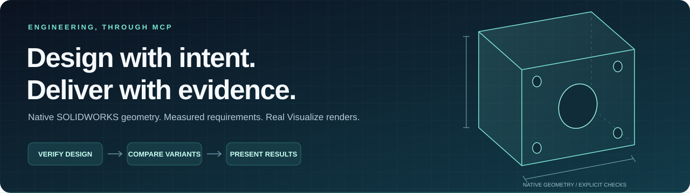
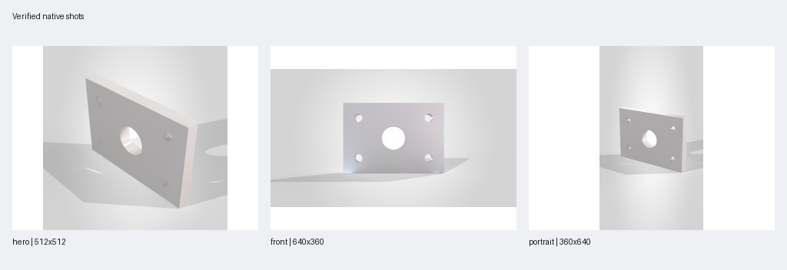
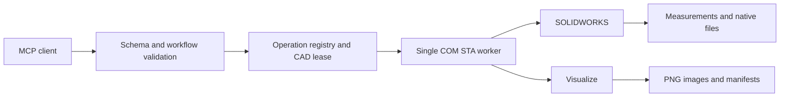

<div align="center">

# SolidWorks MCP PRO

**An independent CAD automation engine. Verified geometry. Native product renders.**

[](CHANGELOG.md)
[](pyproject.toml)
[](#requirements)
[](docs/native-engine.md)
[](LICENSE)

[Quick start](#quick-start) &nbsp;·&nbsp; [What you can do](#what-you-can-do) &nbsp;·&nbsp; [Examples](#workflow-examples) &nbsp;·&nbsp; [Native engine](docs/native-engine.md) &nbsp;·&nbsp; [Verification](#verification)

</div>



A local **Model Context Protocol (MCP) server** that connects an AI assistant to your running SOLIDWORKS session. Build and inspect native models, test explicit requirements, compare isolated part variants, and produce real SOLIDWORKS Visualize images—with measurements and artifacts you can inspect.

**v0.7.0 replaces the external CAD MCP dependency with 88 independently implemented tools.** The native binding, STA worker, document policy, geometry operations and transaction guard live in this repository. SOLIDWORKS supplies the licensed CAD application and geometry kernel. [Engine architecture and tool catalogue](docs/native-engine.md).

| Full profile | Compact profile | Parameter studies | Product shot packs |
|:---:|:---:|:---:|:---:|
| **123 tools** | **14 workflow tools** | **Up to 16 variants** | **Up to 12 shots** |
| 88 independent CAD + 35 PRO | On-demand schemas | 1–2 driving dimensions | Square, landscape, portrait |

## What you can do

| Your task | What PRO delivers |
|---|---|
| **Build a part from dimensions** | Native sketches and features through the CAD tools, followed by measurements and a viewport image. |
| **Check a design against requirements** | Actual values, tolerances, and separate **pass / fail / unknown** results for dimensions, mass, volume, bounds, and supported component clearances. |
| **Compare thicknesses or sizes** | Independent part copies, rebuild and dimension checks, a mass-based ranking of valid candidates, and CSV/JSON reports. |
| **Create product images** | Aspect-matched previews, final native PNGs, a contact sheet, and a manifest with image hashes. |
| **Inspect an assembly** | Components, references, mates, configuration state, and optional native geometry/interference checks. |
| **Prepare a rendering scene** | Installed appearances, RGB overrides, HDRI/background controls, supported lighting settings, and cameras. |
| **Diagnose your connection** | Running Python/package identity, source-version mismatches, published tool profiles, and optional redacted client-configuration inspection. |

**Try asking your connected assistant:**

> Create a 100 × 70 × 10 mm plate with four Ø8 mm mounting holes and a Ø24 mm center hole. Check its volume against the analytic value, then show the native model.

> Compare 6, 8, and 10 mm thicknesses on separate copies. Keep the source unchanged, check the requirements, and rank valid candidates by mass.

> Produce a square hero shot, a landscape front view, and a portrait product shot. Use the project rendering route and show the contact sheet.

### Real output, from a real acceptance run



<p align="center"><sub>A newly generated test plate, rendered locally through the explicit project-camera route. These are native render outputs, not AI-generated product images.</sub></p>

The acceptance fixture also verified a **40 mm component clearance**, three independently generated thickness variants, and restoration of the original camera and active document. [Read the evidence and scope](docs/validation-v0.6.0.md).

## Quick start

Use **64-bit Python 3.11+**; Python **3.12** is recommended for this local COM setup. Native CAD requires Windows and licensed SOLIDWORKS. Rendering additionally requires an installed, licensed Visualize setup.

```powershell
git clone https://github.com/U-C4N/Solidworks-MCP-PRO.git
cd Solidworks-MCP-PRO
.\scripts\setup.ps1 -Dev
.\.venv\Scripts\python.exe -m solidworks_mcp_pro --version
.\.venv\Scripts\python.exe -m solidworks_mcp_pro --doctor
```

Setup generates client snippets in `artifacts/configs/`. Merge the appropriate snippet into your existing client configuration, then reconnect the MCP server. Existing client settings are preserved. [Complete client setup](docs/clients.md).

<details>
<summary><strong>Example: local stdio configuration</strong></summary>

Replace the checkout path with your actual location. The generated snippet already contains your absolute paths.

```toml
[mcp_servers.solidworks-pro]
command = "C:/path/to/Solidworks-MCP-PRO/.venv/Scripts/python.exe"
args = ["-m", "solidworks_mcp_pro", "--tool-profile", "compact"]
cwd = "C:/path/to/Solidworks-MCP-PRO"
startup_timeout_sec = 30
tool_timeout_sec = 180
```

</details>

Once connected:

1. Call `pro_connection_doctor` to check the identity and catalogue of the running PRO server.
2. Call the native `get_status` to attach to an already running SOLIDWORKS session.
3. For rendering, explicitly load the installed add-in with `pro_visualize_status(load_if_missing=true)` if needed.
4. Use the workflows below. Poll long-running work instead of submitting it again.

`compact` publishes 14 workflow tools and retrieves individual contracts through `pro_tool_help`. Native CAD steps remain available through `pro_run_plan`. `full` publishes all 123 tools and is the server default; generated client snippets select `compact`.

## Workflow examples

### 1. Verify design requirements

**Tool:** `pro_validate_design`

Check explicit dimensions, mass, volume, axis-aligned bounds, or supported exact component-pair distances. Every assertion includes a unit and tolerance.

<details>
<summary><strong>Request: 10 mm thickness and mass below 1 kg</strong></summary>

```json
{
  "document_path": "C:\\Models\\Plate.SLDPRT",
  "assertions": [
    {"id": "thickness", "kind": "dimension", "name": "D1@BlockExtrude", "unit": "mm", "expected": 10, "abs_tolerance": 0.01},
    {"id": "weight", "kind": "mass", "unit": "kg", "max": 1, "abs_tolerance": 0}
  ]
}
```

Use the exact dimension name from your model. `D1@BlockExtrude` is an example, not a universal feature name.

</details>

**Result:** Per-requirement actual values, effective tolerances, counts, and evidence. `ok:true` means the checks completed; `passed:true` additionally means every requirement held. Unavailable or uncertain measurements are **unknown**, never a pass. The scan does not rebuild, save, or activate another document.

### 2. Compare isolated parameter variants

**Tool:** `pro_variant_study`

Evaluate explicit combinations of one or two driving dimensions on fresh copies of a saved, self-contained part. The Cartesian product is limited to 16 candidates.

<details>
<summary><strong>Request: plan 6 / 8 / 10 mm thickness variants</strong></summary>

```json
{
  "document_path": "C:\\Models\\Plate.SLDPRT",
  "request_id": "plate-thickness-001",
  "parameters": [
    {"dimension": "D1@BlockExtrude", "unit": "mm", "values": [6, 8, 10]}
  ],
  "dry_run": true
}
```

Review the plan, then execute the same definition with `dry_run:false`. Optional `assertions` use the design-validation contract.

</details>

**Result:** Separate `.sldprt` files, rebuild and signed-dimension readbacks, mass/volume/bounds, valid-candidate rankings, and CSV/JSON reports. Source bytes and the open source's observed state are checked; only owned copies are closed. This compares supplied alternatives—it is not a strength analysis or an automatic optimizer.

### 3. Generate a product shot pack

**Tool:** `pro_shot_pack`

Render up to 12 explicit views with matching preview/final aspect ratios, then collect the images into a labelled contact sheet and manifest.

<details>
<summary><strong>Request: square hero, landscape front, portrait custom view</strong></summary>

```json
{
  "document_path": "C:\\Models\\Plate.SLDPRT",
  "request_id": "plate-shots-001",
  "render_route": "project",
  "shots": [
    {"name": "hero", "view": "isometric", "aspect": "square"},
    {"name": "front", "view": "front", "aspect": "landscape"},
    {"name": "portrait", "view": "custom", "from_direction": [1, 0.55, 1.4], "aspect": "portrait"}
  ],
  "passes": 100,
  "denoiser": true
}
```

Presets are 1024×1024, 1920×1080, and 1080×1920. Supply both `width` and `height` to override a preset, up to 4096 pixels per edge.

</details>

| Render route | Camera behavior | Requirements |
|---|---|---|
| **`project`** — used above | Fits an explicit perspective camera to verified native bounds and the output aspect ratio. Exports once, then renders owned SVPJ copies. | Compatible installed Offline Renderer and 2026 grouped export. |
| **`addin`** — default | Transfers the current native model-view framing. Portrait composition may crop differently from the viewport. | Installed/licensed Visualize and 2025+ add-in API. |

The project route supports isometric/front/back/left/right and world-Y-up custom directions, with zoom-out factors of 0.25–1. Unsupported directions are rejected before CAD work. Routes do not silently fall back. Project-copy ground shadows are on and reflections off. [Full framing contract](docs/engineering-workflows.md#product-shot-packs).

**Result:** Native PNGs, exact dimensions and SHA-256 hashes, previews, a contact sheet, and a JSON manifest. The original model-view camera is restored and verified. Image integrity does not certify artistic quality or material fidelity.

### Follow long-running work

A render or variant execution returns an `operation_id`. Poll `pro_operation` with `wait_seconds:20`. Retrieve a final image with `pro_result(kind="image")`; the default shot-pack image is the contact sheet. Select `artifact_id` for a particular shot.

Concise responses retain counts, failures, cleanup and report links. Full evidence is available through `details_uri` or `pro_result(kind="details")`.

## More of the toolkit

- **Native modeling:** Independent sketches, extrusions, revolutions, sweeps, lofts, holes, ribs, patterns, shelling, body operations, dimensions, equations, materials, drawings and export.
- **Health and repair:** Feature/equation/reference/mate diagnosis, optional deep checks, repair planning and separately authorized application.
- **Presentation:** RGB batches, installed `.p2m` appearances, HDRI/background controls, supported light settings, model-view and named cameras.
- **Assembly preparation:** Reference-preserving cloning, configuration selection, explicit poses and visibility control.
- **Offline inspection:** STL topology/bounds/volume inspection, standalone HTML viewers, and SVG previews.
- **Animation groundwork:** Native frame-preparation tools and geometric sheet bending. [Animation scope](docs/animation.md).

## Verification

Portable automated tests, Windows COM contracts and real CAD acceptance are reported separately. The independent engine is tested with the external CAD MCP package uninstalled. The GitHub matrix covers Windows/Linux with Python 3.11/3.12; Windows COM contracts are skipped on Linux.

Real acceptance on **SOLIDWORKS 2026 SP4.1** checked analytic plate volume, an intentionally failing requirement, three isolated variants, assembly bounds/clearance/mass, add-in renders, project-camera shot packs, and verified cleanup. This is evidence for the documented fixture and installation, not universal CAD or renderer compatibility.

```powershell
.\.venv\Scripts\python.exe -m pytest -q
.\.venv\Scripts\python.exe -m ruff check src tests scripts benchmarks
.\.venv\Scripts\python.exe scripts\smoke_stdio.py
```

Native opt-in acceptance uses newly generated scratch documents and requires an initially empty running SOLIDWORKS session:

```powershell
.\.venv\Scripts\python.exe scripts\validate_render_live.py --live --load-addin --output artifacts\render-check-new
.\.venv\Scripts\python.exe scripts\validate_native_core_live.py --live --group all --output artifacts\native-core-check-new
.\.venv\Scripts\python.exe scripts\validate_engineering_live.py --live --render --render-route project --output artifacts\engineering-check-new
```

[Verification report](docs/validation-v0.6.0.md) · [Portable native evidence](docs/evidence/v0.6.0-native.json) · [GitHub Actions](https://github.com/U-C4N/Solidworks-MCP-PRO/actions)

## Requirements

| Capability | Required environment |
|---|---|
| Offline mesh tools and portable tests | Python 3.11+; no SOLIDWORKS session required. |
| Native CAD workflows | Windows, installed/licensed SOLIDWORKS. |
| Add-in rendering | Installed/licensed Visualize with 2025+ add-in API. |
| Part-grouped SVPJ export / native project opening | 2026+ API. |
| Project shot-pack route | Compatible installed Visualize Offline Renderer plus grouped export. |

### Operating boundaries

- All native COM work is serialized on one STA worker. Independent automation clients do not share PRO's lease.
- Plans are sequential and non-atomic. Earlier successful steps may remain after a later failure.
- Operation and request-ID memory lasts for one server process. After a restart or uncertain timeout, inspect native state before resubmitting.
- Model identity, dimension names, tolerances, material choices, and movement targets must be explicit. Measurements do not establish manufacturing correctness.
- Native scene/RealView behavior depends on the local installation. RGB readback does not prove Visualize `.p2m` fidelity.
- The connection doctor checks identity and catalogue evidence; it does not start CAD. An offline doctor report cannot establish another chat's live connection.

Outputs default to `Documents/Solidworks-MCP-PRO`. Override with `SW_MCP_PRO_WORKSPACE`; generated client snippets use the checkout's `artifacts/` directory.

## Architecture



## Documentation

| Get connected | Workflows and evidence | Rendering and internals |
|---|---|---|
| [Client setup](docs/clients.md) | [Engineering workflows](docs/engineering-workflows.md) | [Visualize integration](docs/visualize.md) |
| [Configuration examples](configs/) | [v0.6.0 verification](docs/validation-v0.6.0.md) | [Animation groundwork](docs/animation.md) |
| [Releases and packages](https://github.com/U-C4N/Solidworks-MCP-PRO/releases) | [Earlier workflow contracts](docs/fast-workflows.md) | [Historical performance evidence](docs/performance-benchmark.md) |

## License

The current CAD automation engine is implemented in this repository and requires no external CAD MCP engine. The project uses the Python MCP SDK and the libraries listed in [third-party notices](THIRD_PARTY_NOTICES.md). Versioned reports describe the implementation used by that release; historical benchmark timings do not measure the new engine.

Released under the **[MIT license](LICENSE)**. SOLIDWORKS and Visualize are trademarks of their respective owners. This is an independent integration.
