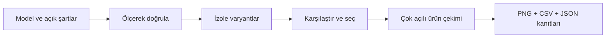

<div align="center">

# SolidWorks MCP PRO

### Tasarla. Ölçerek doğrula. Alternatifleri karşılaştır. Gerçek render ile sun.

[](CHANGELOG.md)
[](pyproject.toml)
[](#gereksinimler)
[](LICENSE)

**SOLIDWORKS için ölçülebilir mühendislik iş akışları ve yerel Visualize çıktıları sunan MCP sunucusu.**

[Hızlı başlangıç](#hızlı-başlangıç) · [Yeni iş akışları](#060-ile-gelenler) · [Canlı doğrulama](docs/validation-v0.6.0.md) · [İstemci kurulumu](docs/clients.md)

</div>


<p align="center"><sub>Bu proje için oluşturulan test parçası · gerçek yerel render · kare, yatay ve dikey çıktı</sub></p>

---

## 0.6.0 ile gelenler

| İş akışı | Ne yapar? | Araç |
|---|---|---|
| **Tasarım şartları** | Ölçü, kütle, hacim, sınır kutusu ve desteklenen açıklık ölçümlerini açık şartlar ve toleranslarla karşılaştırır. | `pro_validate_design` |
| **Parametrik varyantlar** | Kaydedilmiş bağımsız parçanın kopyalarında 1–2 ölçüyü tarar; en fazla 16 alternatifi doğrular, karşılaştırır ve CSV/JSON raporlar. | `pro_variant_study` |
| **Ürün görsel paketi** | Birden fazla açı ve en-boy oranında gerçek önizleme/final PNG'ler, karşılaştırma görseli ve manifest üretir. | `pro_shot_pack` |
| **Bağlantı doktoru** | Çalışan Python, paket/kaynak sürümü, araç profili ve seçilen istemci ayarları arasındaki uyumsuzlukları raporlar. | `pro_connection_doctor` |
| **Gerçek render kontrolü** | Yeni bir test parçasıyla add-in/makro yolunu veya ayrı bir SVPJ kopyasıyla proje renderer'ını sınar; gerçek PNG'yi ve temizliği doğrular. | `scripts/validate_render_live.py` |

CAD çekirdeği, sabitlenmiş **`hjbaard/solidworks-mcp==0.19.0`** bağımlılığıdır. Çekirdeğin 88 aracı üzerine PRO iş akışları eklenir; bu araçların tamamının bu projede sıfırdan yazıldığı iddia edilmez. [Üçüncü taraf bildirimi](THIRD_PARTY_NOTICES.md)



## Birkaç cümleyle kullanım

> **Doğrula:** Aktif parçanın kalınlığı 10 mm, hacmi verdiğim beklenen değere uygun ve kütlesi 1 kg altında mı? Toleransları kullan; sonucu ölçümlerle raporla.

> **Karşılaştır:** `D1@BlockExtrude` kalınlığını 6, 8 ve 10 mm olarak ayrı kopyalarda dene. Kaynağı koru, şartları geçen alternatifleri kütlelerine göre sırala.

> **Sun:** Bu parçanın izometrik kare, önden yatay ve özel açıdan dikey ürün görsellerini al. Her çekim için aynı oranda önizleme üret; karşılaştırma görselini göster.

> **Bağlantıyı kontrol et:** Çalışan PRO sürümünü ve yayımlanan araç profilini doğrula. Yerel kaynakla kurulu paket farklıysa açıkça belirt.

## Hızlı başlangıç

64-bit Python **3.11+** gerekir; yerel COM uyumluluğu için **3.12 önerilir**.

```powershell
git clone https://github.com/U-C4N/Solidworks-MCP-PRO.git
cd Solidworks-MCP-PRO
.\scripts\setup.ps1 -Dev
.\.venv\Scripts\python.exe -m solidworks_mcp_pro --version
.\.venv\Scripts\python.exe -m solidworks_mcp_pro --doctor
```

Kurulum, `artifacts/configs/` altına Codex ve Claude için ayar örnekleri yazar. Mevcut istemci ayarlarını kendiliğinden değiştirmez. Örnekleri mevcut ayarlarınıza birleştirin ve MCP bağlantısını yeniden başlatın. [Ayrıntılı kurulum](docs/clients.md)

```toml
[mcp_servers.solidworks-pro]
command = "C:/path/to/Solidworks-MCP-PRO/.venv/Scripts/python.exe"
args = ["-m", "solidworks_mcp_pro", "--tool-profile", "compact"]
cwd = "C:/path/to/Solidworks-MCP-PRO"
startup_timeout_sec = 30
tool_timeout_sec = 180
```

**`compact`** profili temel iş akışlarını yayımlar; `pro_tool_help` ile tek bir aracın tam sözleşmesi alınır. Yerel CAD araçları `pro_run_plan` içinde kullanılabilir. **`full`** bütün CAD ve PRO araçlarını yayımlar; sunucunun varsayılanıdır.

CAD iş akışlarından önce `get_status` ile çalışan SOLIDWORKS oturumuna bağlanın. Bağlantı doktoru CAD'i başlatmaz veya CAD bağlantısı kurmaz. Render öncesinde `pro_visualize_status(load_if_missing=true)` ile kurulu eklenti açıkça yüklenebilir.

### Bağlantı kontrolü

İstemci içinden `pro_connection_doctor` çağırmak o çalışan PRO sunucusunun gerçek kataloğunu kontrol eder. Yerel rapor için:

```powershell
.\.venv\Scripts\python.exe -m solidworks_mcp_pro.connection_doctor --include-default-clients --tool-profile compact
```

Çevrimdışı rapor, başka bir sohbetin gerçekten bu sunucuya bağlı olduğunu kanıtlamaz. Canlı katalog gözlemi verilmediğinde bunu `incomplete` olarak belirtir. Kontrol hiçbir yapılandırılmış komutu çalıştırmaz ve gizli ortam değerlerini rapora kopyalamaz.

## İş akışı örnekleri

### Tasarım şartlarını doğrula

```json
{
  "document_path": "C:\\Models\\Plate.SLDPRT",
  "assertions": [
    {"id": "thickness", "kind": "dimension", "name": "D1@BlockExtrude", "unit": "mm", "expected": 10, "abs_tolerance": 0.01},
    {"id": "weight", "kind": "mass", "unit": "kg", "max": 1, "abs_tolerance": 0}
  ]
}
```

`ok:true` taramanın tamamlandığını, `passed:true` şartların geçtiğini belirtir. Şart tutmadığında `passed:false`; ölçülemeyen kontroller `unknown` olarak raporlanır. Sağlam CAD geometrisi ile istenen tasarım şartlarının sağlanması ayrı değerlendirilir.

### Varyantları önce planla

```json
{
  "document_path": "C:\\Models\\Plate.SLDPRT",
  "request_id": "plate-thickness-001",
  "parameters": [
    {"dimension": "D1@BlockExtrude", "unit": "mm", "values": [6, 8, 10]}
  ],
  "dry_run": true
}
```

`pro_variant_study` varsayılan olarak plan üretir. Aynı tanımı `dry_run:false` ile çalıştırın. Her alternatif ayrı parça dosyasına yazılır; kaynak parça değiştirilmez. İlk kapsam, kaydedilmiş ve harici referans içermeyen bağımsız parçalardır. Sonuç bir dayanım veya FEA analizi değildir.

### Görsel paketi üret

```json
{
  "document_path": "C:\\Models\\Plate.SLDPRT",
  "request_id": "plate-shots-001",
  "render_route": "project",
  "shots": [
    {"name": "hero", "view": "isometric", "aspect": "square"},
    {"name": "front", "view": "front", "aspect": "landscape"},
    {"name": "portrait", "view": "custom", "from_direction": [1, 0.55, 1.4], "aspect": "portrait"}
  ],
  "passes": 100,
  "denoiser": true
}
```

Önizleme her çekimin en-boy oranını korur. Örnekteki **`project` rotası**, modeli bir kez SVPJ'ye aktarır ve gerçek sınır kutusundan hesaplanan kamerayla dikey çekimde de parçayı kadraja sığdırır. Bu rota uyumlu Visualize Offline Renderer ve 2026 gruplamalı dışa aktarma ister. Varsayılan **`addin` rotası** mevcut model görünümünü kullanır; özellikle dikey çıktıda yerel kamera aktarımı kırpılmaya yol açabilir.

Kamera, başarı ve hata yollarında geri yüklenip kontrol edilir. Paket mevcut malzemeleri kullanır; proje kopyasında zemin gölgeleri açık, yansımalar kapalıdır. Otomatik bir estetik kalite kararı vermez. İlk çoklu çekim akışı normal görünüşler içindir; açık patlatma dönüşümleri `pro_render_job` aracında ayrıca kullanılabilir. Project rotasının desteklenen yönleri ve sınırları [iş akışı belgesinde](docs/engineering-workflows.md) açıklanır.

Uzun işler `operation_id` döndürür. `pro_operation(wait_seconds=20)` ile izleyin; tamamlanan görseli `pro_result(kind="image")` ile alın. Yeni iş akışlarının varsayılan sonuçları özetlidir; ayrıntılar `details_uri` veya `pro_result(kind="details")` içinde korunur. [Tam sözleşmeler ve sınırlar](docs/engineering-workflows.md)

## Diğer yetenekler

- **Modelleme:** Eskizler, parametrik ölçüler, katı modelleme, montajlar, ölçüm ve dışa aktarma için çekirdek CAD araçları.
- **Sağlık kontrolü:** Hatalı unsurlar, denklemler, referanslar ve mate'ler; isteğe bağlı yerel geometri/çakışma taraması.
- **Kontrollü onarım:** Önce salt okunur plan, ayrı talimatla uygulama; eskimiş plan ve tekrar çağrı kontrolleri.
- **Görünüm:** Toplu RGB, yerel `.p2m` atama, HDRI/sahne/ışık, model görünümü ve adlandırılmış kameralar.
- **Visualize:** Yerel PNG/JPEG render, `.svpj` dışa aktarma ve sahip olunan proje kopyasında Offline Renderer.
- **Montaj hazırlığı:** Referanslarıyla klonlama, konfigürasyon seçimi, açık pozlama ve görünürlük.
- **İnternetsiz önizleme:** STL inceleme, HTML döndürme/yakınlaştırma ve SVG çıktıları.

Animasyon için kare hazırlama araçları mevcuttur; genel, tek çağrılık video üretimi bu sürümün kapsamı değildir. [Animasyon altyapısı](docs/animation.md)

## Gereksinimler

| Kullanım | Gerekenler |
|---|---|
| Çevrimdışı STL / birim testleri | Python 3.11+; SOLIDWORKS gerekmez |
| CAD ve mühendislik iş akışları | Windows, kurulu ve lisanslı SOLIDWORKS |
| Add-in üzerinden render | Lisanslı SOLIDWORKS Visualize, 2025+ add-in API |
| Gruplamalı SVPJ / yerel proje açma | 2026+ API |
| Proje renderer'ı | Uyumlu kurulu Visualize Offline Renderer; add-in testinden ayrı doğrulanır |

## Doğrulama ve geliştirme

```powershell
.\.venv\Scripts\python.exe -m pytest -q
.\.venv\Scripts\python.exe -m ruff check src tests scripts benchmarks
.\.venv\Scripts\python.exe scripts\smoke_stdio.py
```

Gerçek add-in render kontrolü, boş bir SOLIDWORKS oturumunda kendi parçasını oluşturup kapatır:

```powershell
.\.venv\Scripts\python.exe scripts\validate_render_live.py --live --load-addin --output artifacts\render-check-new
```

Gerçek CAD/render kanıtları ile sahte backend kullanan otomatik testler ayrı raporlanır. Dosya biçimi, piksel boyutu ve hash kontrolü görsel kompozisyonun veya malzeme doğruluğunun kanıtı değildir. [v0.6.0 kabul kaydı](docs/validation-v0.6.0.md)

## Bilinen sınırlar

- Bütün yerel COM işlemleri tek STA iş parçacığında sırayla çalışır. PRO kilidi, bağımsız başka otomasyon istemcilerini koordine etmez.
- İş ve `request_id` hafızası süreç ömrüyle sınırlıdır. Yeniden başlatma sonrası belirsiz işlemleri körlemesine tekrarlamayın.
- Planlar atomik değildir; hata öncesindeki başarılı değişiklikler kalabilir. Geri yükleme başarısı yalnız doğrulandıysa raporlanır.
- Visualize çıktısında RGB ile `.p2m` görünümü farklı davranabilir. Gerçek küçük render üzerinden kontrol edin.
- RealView ve zemin/sahne özellikleri donanıma ve yerel kuruluma bağlıdır. Desteklenmeyen ayarlar açık hata olarak korunur.
- Yeni iş akışları tam dosya yolu ve açık hedefler ister. Ölçü, malzeme, tolerans, hareket veya üretim niyeti tahmin edilmez.

Varsayılan çıktılar `Documents/Solidworks-MCP-PRO` altındadır; `SW_MCP_PRO_WORKSPACE` ile değiştirilebilir. Üretilen istemci örnekleri proje içindeki `artifacts/` klasörünü kullanır.

## Mimari ve belgeler

`MCP stdio → şema / plan doğrulama → iş kaydı + CAD kilidi → tek COM STA → SOLIDWORKS / Visualize`

[İş akışları](docs/engineering-workflows.md) · [Render ayrıntıları](docs/visualize.md) · [Önceki hızlı akışlar](docs/fast-workflows.md) · [Geçmiş performans ölçümleri](docs/performance-benchmark.md) · [Değişiklik günlüğü](CHANGELOG.md)

**MIT lisansı.** SOLIDWORKS ve Visualize adları ilgili sahiplerinin markalarıdır. Bu proje bağımsız bir entegrasyondur.
