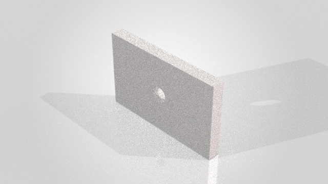

# Validation — v0.2.0, 3 November 2026

This release was exercised on Windows 11 x64 with Python 3.12.16,
SOLIDWORKS 2026 SP4.1 (API revision `34.4.1`), Visualize 2026,
`solidworks-mcp==0.19.0`, MCP SDK 1.30.0 and comtypes 1.4.17.

## Native comparative evidence

Four pinned competitors and PRO completed the same plate, through-hole,
parametric depth edit, mass query and STEP export workflow three times per
adapter. A frozen PRO 0.1.0 baseline was also run in both measurement batches.
Every adapter passed 18/18 recorded CAD acceptance checks and 3/3 document
cleanup checks. A separate COM read verified analytic volume and bounds after
each modeling stage. The oracle is independent of the tool response, but uses
the same SOLIDWORKS kernel; this is not a second-kernel comparison.

The current PRO mass-query median was 104.869 ms versus 430.069 ms for frozen
PRO in the same run (75.6% lower). The complete sequence median was 7508.313 ms
versus 6958.441 ms (7.9% higher). These are descriptive observations from three
repetitions, not statistical significance or an overall speedup claim.

Default export preservation improved from 0/3 to 3/3 and matched the C# rival
in this probe. Unknown-argument rejection remained 3/3. These default-policy
checks are separate from geometry correctness.

See [full results](benchmark-results.md), [raw before evidence](../benchmarks/results/live-before.json),
[raw after evidence](../benchmarks/results/live-after.json) and [protocol results](../benchmarks/results/protocol-all.md).
Andrew's discovery run used its upstream mock adapter; its three geometry runs
used actual native SOLIDWORKS. This distinction is preserved in the reports.

## Visualize and end-to-end smoke

`python scripts/smoke_stdio.py --render` passed on v0.2.0 after the comparative
runs. It verified MCP initialization and 101 tools, prompts/resources, invalid
plan rejection, a complete CAD plan, in-process request replay, independent
expected-volume comparison, SLDPRT/STEP output, screenshot image content,
offline STL preview, actual Visualize render and native SVPJ export.

Local evidence: `artifacts/acceptance/f08894009933/evidence.json`.
The source package includes [sanitized evidence](acceptance-evidence-v0.2.0.json).

| Output | Verification |
|---|---|
| Visualize PNG | 640 × 360, 50 passes, denoiser off; decoded dimensions/format; 292786 bytes |
| PNG SHA-256 | `6259c68d326f1cb6081f49ae93e4d984fcdb2bd2fe89252be076d60c2ee51933` |
| Part-grouped SVPJ | 7179804 bytes; native `SaveWithPartGrouping` returned success |
| SVPJ SHA-256 | `afa3ae1697470c066bd0593c5f2ef6651fee56fa9b0e141a2fcbca561e56c2db` |



The image was visually inspected: plate, central bore and shadows are visible.
It is a noisy, low-pass smoke image, not a finished product rendering. Material
fidelity is not established by a successful appearance-setting call. SVPJ was
verified as a nonempty file with a digest, not reopened and scene-audited.

## Automated checks and limitations

**259 automated tests passed** locally. Ruff reported no violations and
`pip check` reported no broken requirements.

The built `solidworks_mcp_pro-0.2.0-py3-none-any.whl` was installed into an
isolated target and exercised through MCP stdio: initialization, 101 tools,
version 0.2.0, the updated guide and bundled viewer/validation resources passed.
Wheel SHA-256: `4dca5d879461e412440413a84f62a7ecec06cfe0af9dbc4db4b4d67a1cac2cf5`.

Run the complete suite and code checks with:

```powershell
.\.venv\Scripts\python.exe -m pytest -q
.\.venv\Scripts\python.exe -m ruff check src tests scripts benchmarks
.\.venv\Scripts\python.exe -m pip check
```

New regressions cover malformed nested points, nonfinite/overflowing values,
documented cross-field geometry rules, whole-plan preflight, normalized file
targets, per-component export collisions, failed-rebuild responses, read-only
STA dispatch and reproducible benchmark analysis. These synthetic checks do
not count as native competitor successes.

An additional analysis of the immutable raw benchmark responses validated
21/21 returned mass-query volumes against their own post-edit COM oracle at
relative tolerance `1e-6`. This is a derived numerical check, not a rerun or a
change to the original timings. The [derived report](../benchmarks/results/mass-volume-checks.json)
records each raw input's SHA-256, run ID, extraction contract and sample result.

Only this SOLIDWORKS/Visualize installation was exercised live. Assembly,
drawing, sheet-metal and complex topology workflows were not comprehensively
benchmarked. Plans retain completed changes after failure; replay protection
is process-scoped; output checks are not atomic against unrelated filesystem
writers. Remote CI is supplied but has not run. See [gap review](pro-gap-review.md)
for the exact remaining limits and [historical acceptance](validation.md) for
the earlier viewer/browser checks.
