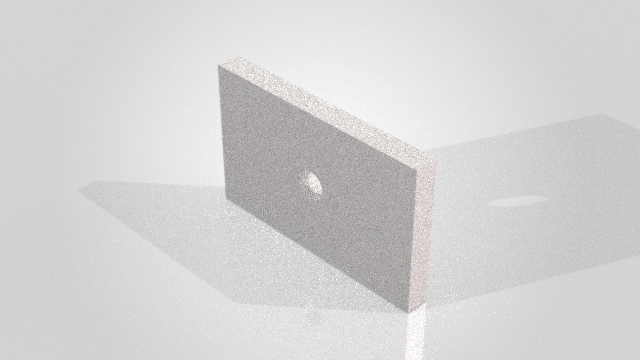

# Validation — v0.3.0, 3 November 2026

This performance release preserves the native rollback snapshot, error
handling, UI restoration, one-STA execution, CAD lease, request replay rules,
whole-plan preflight, failed-rebuild detection and existing-file protection.

The native change moves `CommandInProgress` before the feature-history read.
The quiet-UI scope remains around the native operation, exactly as in the
pinned engine. The first `new_part` performs its existing connection step
before setting command mode; no other tool is eagerly connected.

At the MCP layer, schemas are checked and validators are created once at
startup. Each request still undergoes JSON normalization, finite-value and
semantic checks, and validation against its cached tool schema. Disabling the
SDK's duplicate schema validation does not disable PRO input validation.

See [investigation and instrumented evidence](performance-investigation.md),
[counterbalanced benchmark](performance-benchmark.md) and [historical 0.2.0
validation](validation-v0.2.0.md). The old 7.9% observation remains available;
it is not a reliable causal estimate because the old ordering and pre-close
policy probes introduced confounds.

## Reproduction

The six-system benchmark completed with **216/216 CAD acceptance checks**
(six per scenario, six measured repetitions per system), all 36 measured
document closes passing, plus six retained warm-up scenarios. Current PRO and
frozen 0.2.0 both passed unknown-argument rejection and no-clobber checks 6/6.
The current source fingerprint matches the code recorded in all six samples.

| Adapter | Total CAD tool-call median, ms |
|---|---:|
| PRO 0.3.0 | 6309.042 |
| PRO 0.2.0 | 9578.293 |
| hjbaard | 10072.386 |
| HarrierPigeon | 10143.178 |
| soheil-mp | 12033.076 |
| Andrew Bartels | 19438.759 |

These totals exclude server initialization, independent oracle reads, policy
fixtures and LLM inference. The complete report includes ranges, standard
deviations, startup time, stage distributions and the counterbalanced order.

The live failed-feature test passed in
`artifacts/guard-acceptance/64f81c39e42e/evidence.json`. Native `FeatureCut4`
failed after the outside-body sketch was created; rollback removed the added
history. The part retained its 32000 mm³ volume and 80 × 50 × 8 mm bounds.
Command, graphics, feature-tree, tree-window and sketch-display flags matched
their initial states. The test document was closed; pre-existing documents
were preserved. [Packaged evidence](guard-acceptance-v0.3.0.json).

**291 automated tests passed** locally; Ruff and `pip check` passed. Coverage
includes the reordered native guard's success/failure/snapshot/rollback paths,
pre-existing command state, first connection failure, per-request validation
through the real MCP handler, failed-rebuild stops, no-clobber rules, replay,
cancellation and lease ownership. Remote CI has not run.

The built wheel was installed into an isolated target and exercised through
MCP stdio: version 0.3.0, 101 tools, guide resources and negative-size rejection
passed. Package code/resources match the benchmarked source; the adapted
upstream guard's license notice is included. Wheel SHA-256:
`9f7d8e0468c30f09d1af0e2d94a3ac9982e0ac3c5d09c11c7efa8fd2e6690e03`.

The post-change `smoke_stdio.py --render` acceptance also passed with 101 tools,
plan/replay checks, measured CAD volume, SLDPRT/STEP export, inline screenshot,
offline preview, actual Visualize render and native part-grouped SVPJ output.
Evidence: `artifacts/acceptance/cc10b99f99f8/evidence.json`; the source package
includes [sanitized results](acceptance-evidence-v0.3.0.json).

| Render output | Verification |
|---|---|
| PNG | 640 × 360, 50 passes, denoiser off; decoded dimensions/format; 292786 bytes |
| PNG SHA-256 | `6259c68d326f1cb6081f49ae93e4d984fcdb2bd2fe89252be076d60c2ee51933` |
| SVPJ | Native `SaveWithPartGrouping` success; 7179799 bytes |
| SVPJ SHA-256 | `6651e4f8e9fc8aa84b4e012c3eae9c63931c52abe30f316c349c123e57e5bfc2` |



This remains a noisy low-pass smoke image, not finished presentation artwork.
Its bytes match the inspected v0.2.0 image of the same fixture. Material fidelity
is not inferred from the appearance-setting call. The exported SVPJ was
verified as a nonempty file with a digest, not reopened and scene-audited.

```powershell
.\.venv\Scripts\python.exe -m pytest -q
.\.venv\Scripts\python.exe -m ruff check src tests scripts benchmarks
.\.venv\Scripts\python.exe -m benchmarks.run_live --live --servers pro,pro_v020,hjbaard,harrier,soheil,andrew --repeats 6 --warmup 1 --seed 20261103 --output artifacts/new-performance-run.json
.\.venv\Scripts\python.exe scripts/check_guard_live.py --live
.\.venv\Scripts\python.exe scripts/smoke_stdio.py --render
```

Run native commands serially against a licensed, idle SOLIDWORKS installation.
Each benchmark uses fresh owned documents and preserves pre-existing documents.
The native recovery script deliberately attempts a polygon cut outside its
own test body, then checks failure reporting, unchanged feature history,
unchanged volume/bounds, and restored command/graphics/tree/sketch flags.

These checks do not establish atomic multi-step rollback, persistent replay
across process restarts, filesystem atomicity against unrelated writers, or
general speed superiority across all CAD tasks. The benchmark covers one
common part-modeling workflow on this SOLIDWORKS 2026 SP4.1 installation.
