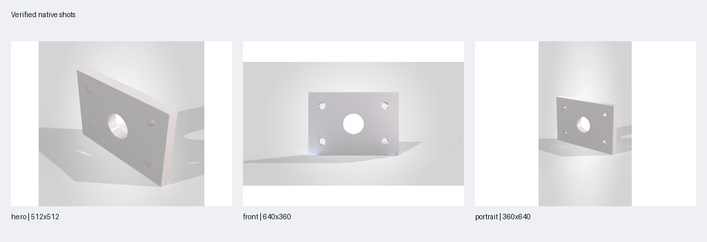

# v0.7.0 verification — 4 November 2026

This release replaces the external CAD MCP runtime with the independent engine
in this repository. Tool registration, offline tests and real SOLIDWORKS results
are separate evidence. The installed external CAD MCP package was removed before
these tests, and the native acceptance process checks it was never imported.

## Automated and protocol checks

- **1,684 local Windows tests passed**, including native SDK contract doubles,
  geometry/assembly algorithms, transactional failure handling and PRO workflows.
- Ruff and dependency consistency checks passed.
- Stdio initialization, all **123 full-profile tools**, prompts, native guide,
  capabilities and expected invalid-plan rejection passed.
- GitHub Actions passed on Windows and Linux with Python 3.11 and 3.12.
  [Independent-engine CI](https://github.com/U-C4N/Solidworks-MCP-PRO/actions/runs/41817121656).

The full native catalogue run used `f2aa03e6aac2411aafe0622fe1afca00953d528d`.
Shared close-state restoration was then hardened in `6c66139` and verified with
five focused native fixtures. Geometry handler implementations did not change. The portable
native evidence records SHA-256 hashes of every native source module, tool
contract and acceptance recipe, including the binding and transaction policy.

## Native CAD catalogue

**88 distinct tools have passing native fixtures.** The full catalogue run
passed 87 cases; `open_assembly` was blocked in its setup when hidden application
visibility did not restore. After the shared UI restoration fix, all five
focused cases passed: part closure, assembly opening, screenshot, drawing and
closed-source component insertion. The focused run exercised a hidden,
user-controlled application precondition.

| Group | Distinct tools with passing native fixtures |
|---|---:|
| Documents and export | 14 |
| Geometry and sketches | 30 |
| Features, dimensions, equations and materials | 24 |
| Assembly, topology and mesh | 20 |
| **Total** | **88** |

[Portable native evidence](evidence/v0.7.0-native.json) keeps both runs, all
measurements, analytic expectations, actual source hashes, blocked prerequisites
and cleanup records. This is an aggregate across the full run and disclosed
focused retest, not a claim that a single 88-case run was wholly green.
Every recorded fixture cleanup was verified. The external CAD MCP package was
absent and never imported in either process.

A long preceding scratch-test sequence accumulated approximately 21 GB in the
CAD process and eventually refused new documents. Its blocked cases were retained;
this is not proof of a particular leak mechanism. The final full run started in
a fresh application session. Use a fresh session for a long catalogue reproduction.
New-document creation now batches COM calls under CommandInProgress and restores
the prior flag on success and failure; no universal speedup is claimed.

## Native engineering and product images

The fresh engineering run used **SOLIDWORKS 2026 SP4.1**, revision `34.4.1`,
64-bit Windows/Python 3.12 and the installed licensed Visualize renderer.

| Check | Observed result |
|---|---|
| Plate analytic volume | 63,465.48728053323 mm³ |
| Four mounting holes plus center hole | Native features and expected solid volume verified |
| Deliberately wrong thickness requirement | Failed as expected |
| Isolated 6 / 8 / 10 mm variants | Three valid saved copies, ranked by native mass |
| Source file/state and prior activation | Preserved and verified |
| Assembly bounds | 240 × 70 × 10 mm |
| Exact component clearance | 40 mm |
| Assembly mass | 0.12693097456106647 kg, twice the source mass |
| Project-camera shot pack | 512×512, 640×360 and 360×640 native PNGs |
| Camera restoration | Verified |
| Owned fixture cleanup | Verified |

The default fixture density was approximately 1,000 kg/m³. The variant masses
were approximately 0.0380793 / 0.0507724 / 0.0634655 kg. These values verify the
measured fixture; they do not establish an engineering material's strength.



[Portable engineering evidence](evidence/v0.7.0-engineering.json) includes the
original measurements, assertions, image hashes, source checks and cleanup.
Machine-specific user and checkout roots are replaced with placeholders.

A separate add-in acceptance probe also passed: a new 8,000 mm³ native box
rendered through the in-process macro route as a decoded 640×360 RGBA PNG.
The macro completion marker, actual image dimensions/hash and owned cleanup were
verified independently. No transparency fidelity claim is made.
[Portable add-in render evidence](evidence/v0.7.0-addin.json).

## Safety and scope

Existing documents require explicit edit adoption. Native operations verify the
exact active target and refuse stale entity references. Failure receipts retain
native undo availability and verify only the reported feature/configuration/
error/volume signature; unverified outcomes never become a success guarantee.
Closing protects other hidden documents and restores their UI control mode.
An assembly can retain component model data after its source window closes;
this is accepted only with an actual surviving component-path reference and a
hidden native window, and is reported separately in the receipt.

STL settings are captured before any change, including coupled quality/tolerance
values, then restored and verified together. User material folders are registered
only during assignment and their exact previous setting is restored afterward.

An earlier application session rejected valid equations through both pywin32 and
an independent comtypes vtable probe; a fixed minimal native VBA probe also
failed. Restarting the empty application restored both equation and VBA support.
No equation evaluator substitute, registry edit or software reinstall was used.
The final native run uses the documented SDK calls.

Acceptance covers the explicit fixtures on this installation, not every optional
parameter or every SOLIDWORKS release. Printability remains screening evidence;
motion and swept envelopes are sampled, not continuous collision guarantees.
Native tessellation comparison uses explicit numeric tolerances. Image integrity
does not certify material fidelity or aesthetic acceptance. Historical benchmark
numbers do not measure this independent engine and no new speed advantage is
claimed.

## Reproduction

Use a new output directory for each command. Native acceptance requires an empty,
running, licensed session and creates/closes only its own scratch fixtures.

```powershell
.\.venv\Scripts\python.exe -m pytest -q
.\.venv\Scripts\python.exe -m ruff check src tests scripts benchmarks
.\.venv\Scripts\python.exe scripts\smoke_stdio.py
.\.venv\Scripts\python.exe scripts\validate_native_core_live.py --live --group all --output artifacts\native-check-new
.\.venv\Scripts\python.exe scripts\validate_engineering_live.py --live --render --render-route project --output artifacts\engineering-check-new
```
