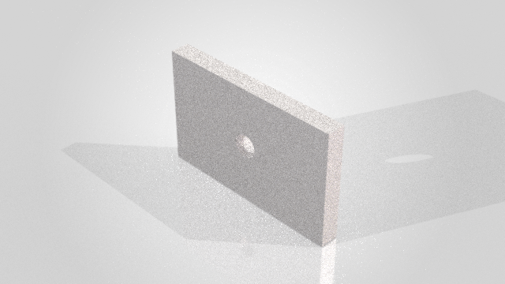

# Historical validation — v0.1.0, 3 November 2026

This is the original acceptance record. See [v0.2.0 validation](validation-v0.2.0.md) and the [subsequent comparative benchmark](benchmark-results.md) for current evidence.

**140 automated tests passed. Live CAD, actual Visualize rendering and SVPJ export passed on this machine.**

Environment: Windows 11 x64, Python 3.12.16, SOLIDWORKS 2026 SP4.1
(API revision `34.4.1`), Visualize 2026, `solidworks-mcp==0.19.0`,
MCP SDK 1.30.0, pywin32 312, comtypes 1.4.17, Pillow 12.3.0.

## Automated and protocol checks

```powershell
.\.venv\Scripts\python.exe -m pytest -q
# 140 passed
.\.venv\Scripts\python.exe -m ruff check src tests scripts
# All checks passed
.\.venv\Scripts\python.exe scripts/smoke_stdio.py
```

Coverage includes complete-plan validation before mutation, sequential failure
handling, replay protection, cancellation/timeout shielding, queued plan/native
lock ordering, bounded operation registry, safe shutdown draining, actual MCP
stdio initialization and discovery, resource reads, image/error result handling,
STL topology/limits, offline viewer output, Visualize output validation and
settings restoration with mocks, and generated Windows client configurations.

The standalone viewer was exercised in headless Chrome: no JavaScript errors,
orbit/preset/wireframe interactions changed rendered pixels, and mobile layout
had no horizontal overflow. Windows setup script syntax and generated JSON/TOML
round trips were checked. GitHub Actions for Windows/Linux and Python 3.11/3.12
are supplied but have **not** run remotely.

## Live acceptance via MCP stdio

Command: `python scripts/smoke_stdio.py --render`.

| Check | Result |
|---|---|
| MCP initialize, tool list, prompt and guide resource | Passed; 101 tools: 88 upstream + 13 PRO |
| Invalid plan | Rejected before CAD calls as intended |
| Validated plan | New part, 80 × 50 × 8 mm block, Ø10 through-hole at (40,25), appearance call |
| Repeat identical request ID | Same operation reused; no second part/feature execution |
| Independent volume comparison | Expected 31371.68146928204 mm³; measured 31371.681469282048 mm³ |
| Native save and neutral export | SLDPRT and STEP created |
| Screenshot | Real PNG returned as MCP image content |
| Offline viewer/resource | STL exported, 160 triangles, 80 × 50 × 8 mm bounds, HTML readable through MCP |
| Visualize API | Typed vtable path succeeded; same-process-ID check passed |
| Photorealistic render | Native Visualize `Render()` succeeded; 640 × 360 PNG, 50 passes, denoiser off |
| Long-running behavior | Render returned an operation ID and was polled until completion |
| Render integrity | Pillow decode, dimensions/format, 292783 bytes, SHA-256 verified |
| Native Visualize project | Part-grouped SVPJ exported; 7179804 bytes, SHA-256 verified |

Render SHA-256:
`d856871b6457a5c15200144a0ffe446d1511ac62de41cbcd1b5293d3c9a6826f`.

Local evidence and all CAD outputs are in
`artifacts/acceptance/fac1ec721802/`. The source package includes a sanitized
copy of the JSON evidence at [acceptance-evidence.json](acceptance-evidence.json).



This low-pass test image is intentionally a smoke-test result, not a finished
product rendering. The image visibly contains the plate and central bore.
Its scene/material appearance requires design review; the appearance-setting
call alone does not prove Visualize material fidelity. Increase passes and
review the scene for a final presentation image.

## Practical limits of the evidence

Only this SOLIDWORKS/Visualize 2026 installation was exercised live. The other
87+ CAD workflows were not all rerun; upstream compatibility/test claims remain
upstream claims. SW2025 fallback, JPEG, denoiser, larger renders and error
recovery paths have unit coverage or documented APIs but were not all exercised
against the live renderer. The exported SVPJ was checked for file creation and
integrity, not reopened and scene-audited in the Visualize UI.

The initial pywin32 dispatch approach failed live with `E_NOINTERFACE`; the
final implementation uses verified typed comtypes vtable calls. The earlier
failed attempts remain in separate local acceptance folders for diagnosis.

At the time of this v0.1.0 acceptance, no competitor had been run through a comparative performance/accuracy benchmark.
The additions are measurable capabilities beyond the selected baseline;
universal superiority, production certification and all-version compatibility
are not established.
